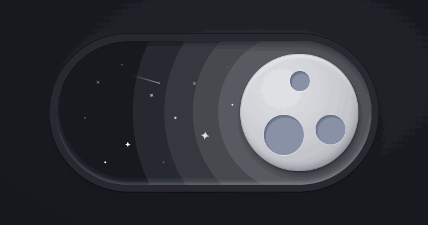
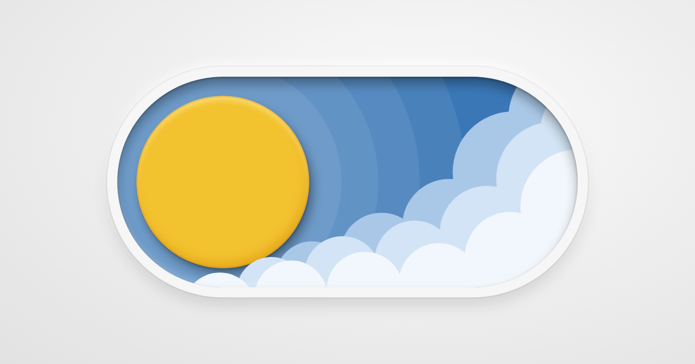
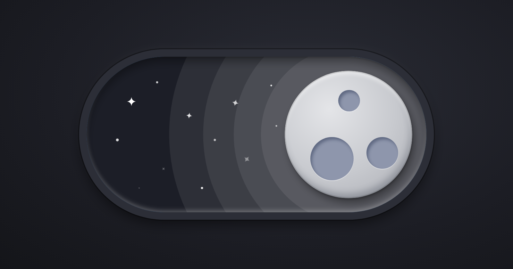

# Day / Night Toggle

An animated day/night switch in plain HTML, CSS and a little JavaScript. No libraries, no build step.

**[Live demo →](https://interactive-day-night-toggle.vercel.app)**



<p align="center">
  
  
</p>

Click it: the sun slides across and the moon covers it like an eclipse, clouds sink away, stars drop in and twinkle, and a shooting star crosses the night sky. Click again to bring the day back.

## Use it

1. Download or clone the repo.
2. Open `index.html` in any modern browser.

| File | What's in it |
|---|---|
| `index.html` | The structure: the button, its layers and the SVG drawings of clouds and stars |
| `style.css` | The look and all the motion: colors, springs, transitions, keyframes |
| `script.js` | About 40 lines: flips day/night on click, the knob's squash-and-stretch, the GitHub star count |

To put it in your own page, copy the `<button class="toggle">…</button>` block, then link `style.css` and `script.js`. The page footer (credits) and the star-count code are optional.

## Change the size

Everything inside the toggle scales from one value:

```css
.toggle { --size: 530px; }   /* default */
.toggle { --size: 120px; }   /* small, e.g. for a navbar */
```

**How this works:** every part (sun, moon, clouds, stars, shadows) is sized in `cqw` units, which means a percentage of the toggle's own width. The shape is locked to a 530 × 243 ratio, so the height follows. On narrow screens the toggle is capped at 80% of the screen width.

## Change the colors

All colors live as variables at the top of `style.css` (`:root`): sky, sun, moon, craters, the three cloud layers and the stars.

## Read the state

The button is a real switch for screen readers (`role="switch"`). `aria-checked="true"` means night. The page `<body>` gets the class `is-night` or `is-day`, so you can hook your own theme onto it:

```js
document.querySelector('.toggle').addEventListener('click', () => {
  const isNight = document.body.classList.contains('is-night');
  // switch your site's theme here
});
```

## How the animation works

- **Springs:** the motion uses spring curves, sampled from a real spring formula into CSS `linear()` easing. You can tune them through `--spring-soft` and `--spring-bouncy`.
- **Knob:** it squashes and stretches as it travels (Web Animations API, about 10 lines of JS).
- **Light bands:** they are box-shadow rings on the knob, so they travel with it and ripple out when it lands.
- **Reduced motion:** users who turn on "reduce motion" in their system settings get a simple fade.

Works in current Chrome, Safari, Firefox and Edge.

## License

MIT — free to use, change and share. Made by [Hamzeh](https://hamzeh.framer.ai).
